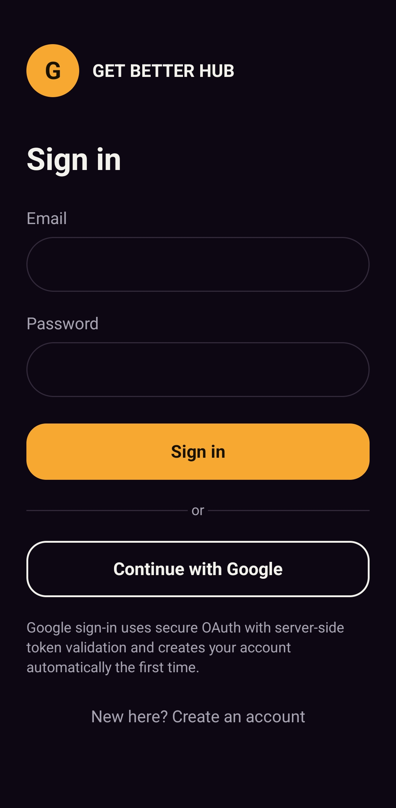
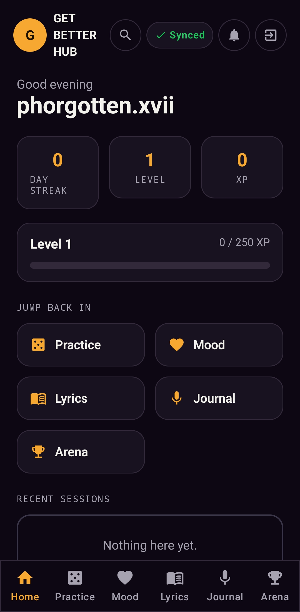
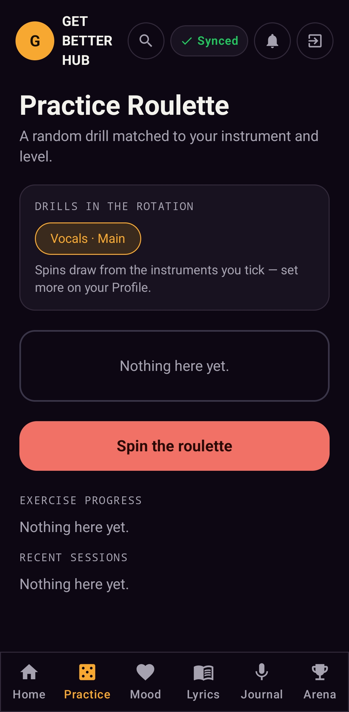
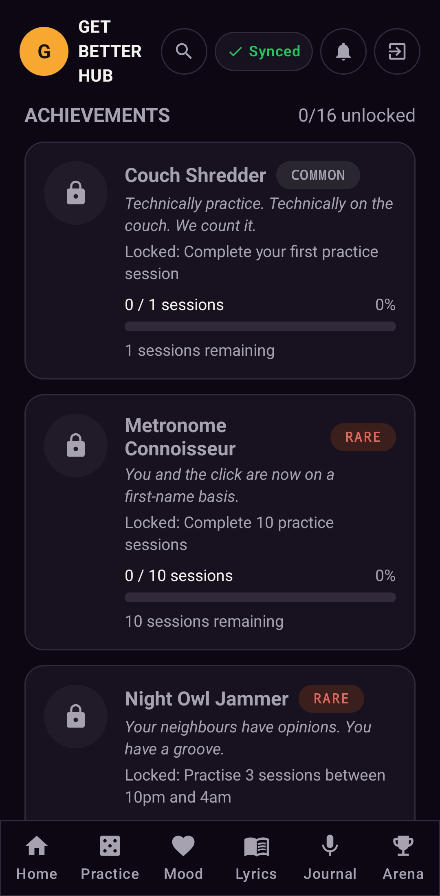
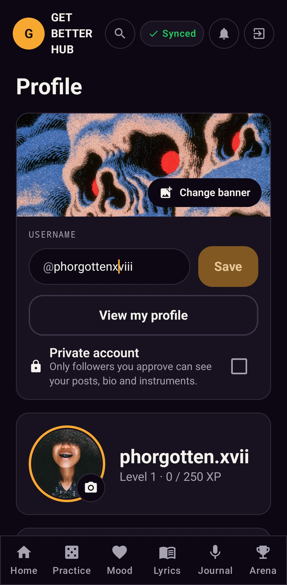
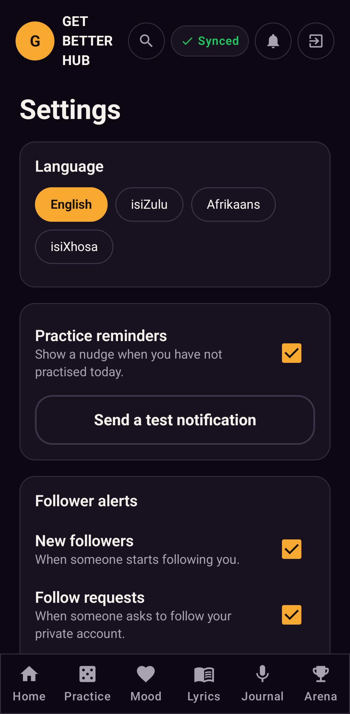
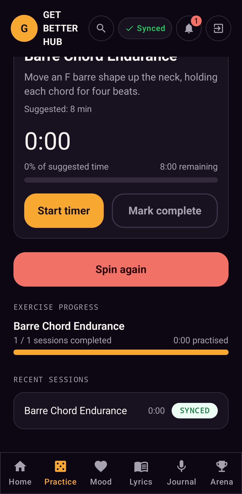

# Get Better Hub (GBH)

A cross-discipline music practice app for Android. It gives you practice drills matched to your instruments and level, mood-based coaching, a lyric sketchpad, an audio practice journal and a community challenge arena. It works offline and syncs to a REST API when you are back online.

Built for **OPSC6312 (Open Source Coding)**, Portfolio of Evidence, **Part 3 (final)**.

**Live API (Azure App Service):** https://gbh-api-siya-gjaqagegf8ajh6g6.southafricanorth-01.azurewebsites.net/swagger

**Demonstration video (final app on a physical phone):** https://youtu.be/b9kKAJYuNGk?si=mXTd2mYtGCbAHchb (Part 2 prototype video: https://youtu.be/sl6WmZgiOac?si=gEWJmVy7EOq6vkgt) 

| | |
|---|---|
| Author | Siyabonga Ndlovu, ST10443863 |
| Platform | Android (Kotlin, Jetpack Compose), minSdk 26, tested on a physical phone |
| Backend | ASP.NET Core 8 Web API, EF Core, SQL Server |
| Languages in the app | English, isiZulu, Afrikaans, isiXhosa |

---

## 1. Purpose of the app

Musicians who teach themselves usually have no plan. They noodle for ten minutes, feel flat, and stop. GBH fixes the "what do I practise today?" problem and keeps people coming back.

- **Practice Roulette** spins a drill from the instruments you tick on your profile, at your level (beginner, intermediate or advanced). There are 63 drills across vocals, guitar, piano, drums, bass, production and songwriting.
- **Mood Coach** picks a drill that suits how you feel and your energy level.
- **Lyric Sketchpad** keeps your lyric drafts, and they sync.
- **Soundscape Journal** records real audio takes on the phone.
- **Challenge Arena** has a feed, challenges, a leaderboard and **achievements**.
- **Profile and public profile** have an avatar, banner, @handle, bio, privacy switches and follower counts.
- **Settings** has the language, reminders, follower alerts and offline sync status.

### The two user-defined features (10 marks each)

These two come from the Part 1 feature list. Both are new since the Part 2 prototype.

1. **Practice Roulette (instrument and level aware).** The drill library, the rotation chips with the "Main" instrument, the timer with percent of suggested time, and per-exercise progress are all new. Each completed drill is stored as a session with its instrument, so the achievements can count it.
2. **Achievements.** 15 core achievements plus one per instrument you practise. Each one has a rarity (Common, Rare, Epic or Legendary), a funny tagline, a requirement and live progress ("2 / 10, 8 sessions remaining"). Some need two conditions, for example "Grammy in Progress" needs 2,500 XP **and** 3 challenges. Unlocking one raises a notification.

## 2. Rubric checklist

| Requirement | Where it lives |
|---|---|
| Register / login, encrypted password | `AuthController` (BCrypt hash), `LoginScreen`, `RegisterScreen` |
| Single sign-on | Google Sign-In, token verified server-side (`/api/auth/google`) |
| Settings | `SettingsScreen` (language, reminders, alerts, sync) |
| REST API + database | ASP.NET Core API + SQL Server (server), Room (phone) |
| Offline mode with sync | Room is the source of truth. `GbhRepository.syncPendingWithServer` runs on sign-in and when the phone reconnects (`NetworkMonitor`) |
| Real-time notifications | See section 5 |
| Multi-language (2+ SA languages) | English, isiZulu, Afrikaans, isiXhosa (`res/values-zu`, `-af`, `-xh`). The whole UI switches at once |
| Automated tests in GitHub Actions | `.github/workflows/ci.yml`, tests in `app/src/test` |
| App icon + image assets | `res/mipmap-*/ic_launcher_foreground.png` (adaptive icon), `docs/images` |
| Release notes | `RELEASE_NOTES.md` |
| Play Store readiness | `docs/PLAY_STORE.md` |
| Comments with references, logging | Source comments, `core/AppLog.kt` (`Log` tag `GBH`) |

## 3. Design considerations

**One consistent look.** Every signed-in screen shares the same top bar (the "G" logo opens your profile, then search, the sync pill, the bell and log out) and the same bottom navigation. Colours and type come from `ui/theme`. Shared pieces (`HubCard`, `HubFilledButton`, `HubTextField`, `HubStatusTag`) are reused everywhere so buttons, cards and tags look the same on every screen.

**Offline-first.** The user should never wait for the network.
1. Every write goes to Room first with `synced = false`.
2. The app then tries to push it straight away.
3. Anything still pending is retried by a sync sweep whenever the phone reconnects.
4. The top-bar pill shows **Synced**, **Syncing** or **Offline**. Settings shows how many changes are waiting and when the last sync was.

**Language.** All text lives in string resources. `LocaleHelper.wrap` applies the chosen language in `MainActivity.attachBaseContext`. Changing it in Settings recreates the activity, so every screen updates. Notification text is translated too, because the background worker builds its own localised context. `tools/gen_strings.py` generates the four `strings.xml` files from one table so the languages cannot drift apart.

**Privacy.** A private account has to approve follow requests. The profile has per-field Public / Private switches for bio, instruments, picture and badges, and the public profile view respects them.

**Security.** Passwords are hashed with BCrypt and never returned by the API. The API uses JWT bearer tokens. Plain HTTP is allowed only for `localhost` and the emulator alias (`network_security_config.xml`). Release builds should use HTTPS.

### Architecture

```
Compose screens  ->  MainActivity (state + navigation)  ->  GbhRepository (Room + sync)  ->  Retrofit  ->  ASP.NET Core API  ->  SQL Server
                                                         ->  NetworkMonitor / Notifier / ReminderWorker (WorkManager)
```

```
GetBetterHub-android/app/src/main/java/com/getbetterhub/app/
├── core/       AppLanguage, SettingsStore, NetworkMonitor, Notifier, ReminderWorker, ImageUtils, AppLog
├── domain/     DrillLibrary, Achievements, Profile (plain Kotlin, unit tested)
├── data/local/ Room database, DAOs, GbhRepository (offline-first + sync)
├── data/remote Retrofit API, network repository, token store
├── ui/         theme, components, screens
└── audio/      MediaRecorder / MediaPlayer wrapper
GetBetterHub-backend/   Controllers (Auth, Users, People, Follows, Notifications, PracticeSessions, JournalEntries, LyricDrafts, PerformancePosts, Uploads), Models, DTOs, Data, Services
```

## 4. How GitHub and GitHub Actions are used

- **Commits.** Work was committed in small steps with messages saying what changed. The final commit is tagged `final POE`.
- **Actions.** `.github/workflows/ci.yml` runs on every push and pull request:
  - `android`: `gradle testDebugUnitTest`, then `gradle assembleDebug`. It uploads the test report and the debug APK as artifacts.
  - `backend`: `dotnet restore` and `dotnet build -c Release` for the API.
- **Tests** (`app/src/test`) cover the drill library (every instrument and level has drills, no repeats on a re-spin, mood matching), the achievement rules (night owl and early bird hours, per-instrument counts, two-condition achievements, capped progress) and profile rules (handle validation, default handle, primary instrument always in the rotation).
- **Secrets stay out of Git.** `.gitignore` excludes `keystore.properties`, `*.jks` and `local.properties`. `keystore.properties.example` shows the format.

## 5. Notifications

- **Practice reminder.** A WorkManager job (`ReminderWorker`) runs hourly. Once a day, between 17:00 and 20:59, it nudges you if you have not practised. It works fully offline and respects the Settings switch.
- **Achievement unlocked.** A notification is raised the moment a new achievement unlocks.
- **Follower activity** (new follower, follow request, request approved). The API stores these events (`/api/notifications`) and the phone pulls them on every sync and shows each one once.
- The bell in the top bar lists them (with an unread dot), and the Settings link in that dropdown opens app settings.
- On Android 13+ the app asks for the notification permission. Settings has a **Send test notification** button.

This is "near real time", driven by WorkManager and sync. Server-pushed FCM messages would need a Firebase project (`google-services.json`) and are listed under future work.

## 6. Running it

### Backend
1. Install the [.NET 8 SDK](https://dotnet.microsoft.com/download) and SQL Server LocalDB.
2. In `appsettings.json` set a real `Jwt:Key` (32+ random characters) and, for Google SSO, `Google:ClientId`.
3. From `GetBetterHub-backend/`:
   ```
   dotnet run
   ```
   If no EF migrations exist the API creates the schema on first run. **If you have an older local database from before this version, drop it first** (the final build added columns and tables).
4. Swagger UI is at `/swagger`.

### Android app on a physical phone
1. Enable **USB debugging** on the phone and plug it in.
2. With the API running on port 5080:
   ```
   adb reverse tcp:5080 tcp:5080
   ```
   The debug build talks to `http://localhost:5080/`, which `adb reverse` forwards to your PC.
3. In Android Studio pick your phone and press Run. To point at another server instead, build with `-PapiBaseUrl=https://your-api.azurewebsites.net/`.
4. Put your Google OAuth **web client ID** in `res/values/strings.xml` (`google_web_client_id`) for SSO.

## 7. Screenshots

Taken on a physical Android phone running the signed build. Files are in `docs/images/screenshots/`. The original design mockups the build follows are kept in the same folder as `mockup-XX.jpg`.

| Sign in (email + Google SSO) | Home (Synced pill, XP, streak) | Practice Roulette |
|---|---|---|
|  |  |  |

| Achievements | Profile | Settings (language, reminders) |
|---|---|---|
|  |  |  |

| Practice session synced to the server |
|---|
|  |

## 8. Known limitations and future work

- Drill, achievement and challenge **content** is English only. The interface around it is translated. The isiZulu, Afrikaans and isiXhosa wording would benefit from a native-speaker review.
- Real server push (FCM) is not included, see section 5.
- Arena comments are counted locally and not yet sent to the API.
- Search and follow need the API to be reachable. Offline, the Search screen says so.

## Author

Siyabonga Ndlovu, ST10443863
